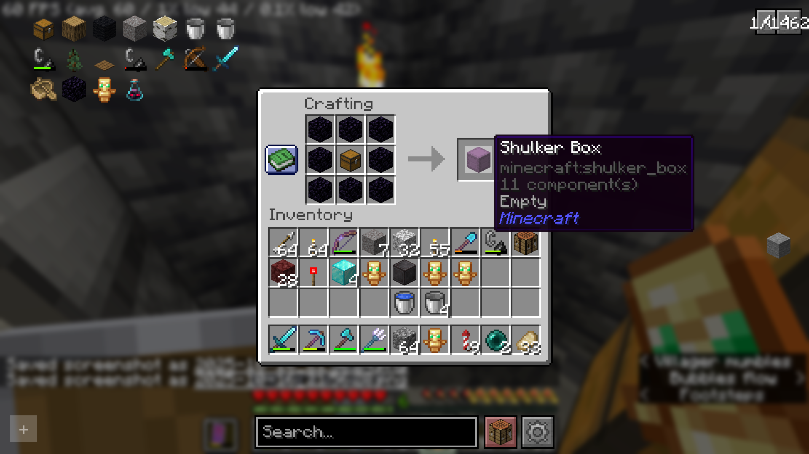
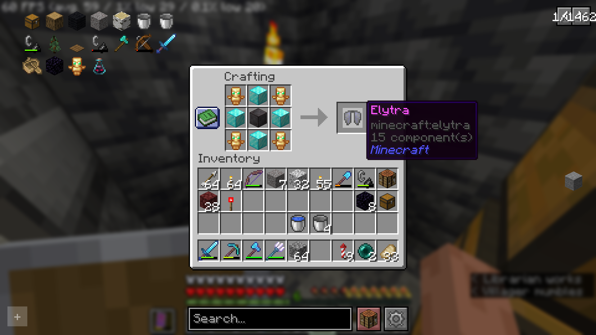

# EnderRecipes

**EnderRecipes** is a flexible Minecraft Paper plugin for 1.21.11+ (Paper 26.3+) that adds custom crafting recipes for vanilla items like the Shulker Box and Elytra. Easily enable or disable recipes via a configuration file—no need to touch datapacks or JSON!  
Built with Java and the PaperMC API.

---

## Features

- **Custom Crafting Recipes**:
    - Craft Shulker Boxes from obsidian and a chest.
    - Craft Elytra using netherite blocks, diamond blocks, and totems of undying.
- **Configurable**:
    - Enable or disable each recipe individually in `plugins/EnderRecipes/config.yml`.
- **Vanilla Items**:
    - All outputs are standard Minecraft items—fully compatible with enchantments, upgrades, etc.
- **Easy to Expand**:
    - Modular code lets you add more custom recipes as needed.

---

## Installation

1. **Download the latest release** from [Releases](../../releases).
2. Place `EnderRecipes.jar` into your server's `plugins/` folder.
3. Start or reload your Paper server.
4. Edit `plugins/EnderRecipes/config.yml` to enable/disable recipes as desired.
5. Reload or restart the server to apply config changes.

---

## Default Recipes

### Shulker Box

**Ingredients:**
- 8x Obsidian (`minecraft:obsidian`)
- 1x Chest (`minecraft:chest`)



### Elytra

**Ingredients:**
- 4x Totem of Undying (`minecraft:totem_of_undying`)
- 4x Diamond Block (`minecraft:diamond_block`)
- 1x Netherite Block (`minecraft:netherite_block`)



## Configuration

After first run, the config file is generated at:  
`plugins/EnderRecipes/config.yml`

```yaml
enable_shulker_box_recipe: true
enable_elytra_recipe: true
```

Set any recipe to `false` to disable it.

---

## Adding More Recipes

Want a new custom recipe in EnderRecipes?  
**Contact me on Discord: [vihaanvp]**

I’m happy to take suggestions and can add more recipes on request.  
Feel free to reach out with your idea, and I’ll consider adding it in a future update!

---

## License

This project is licensed under the MIT License. See [LICENSE](LICENSE) for details.

---